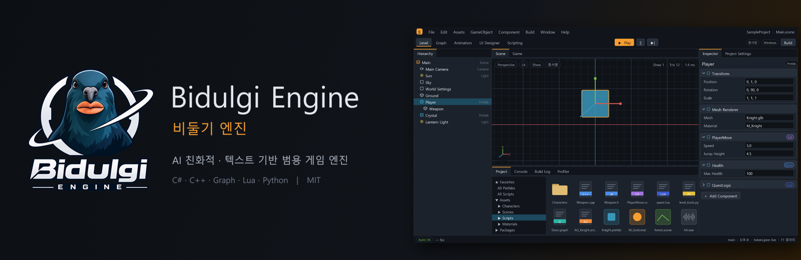
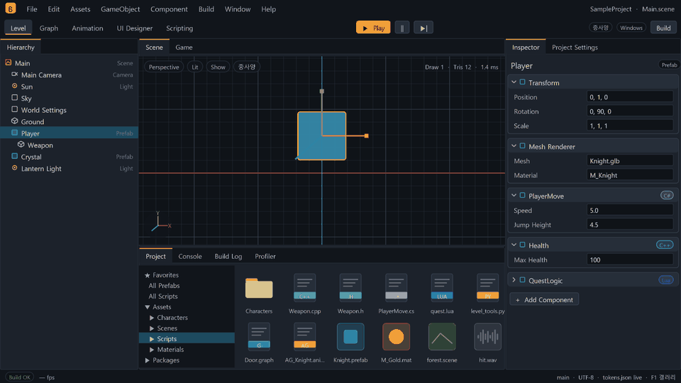
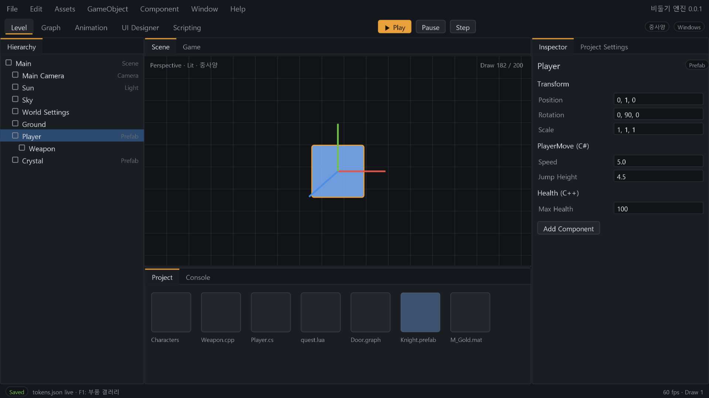
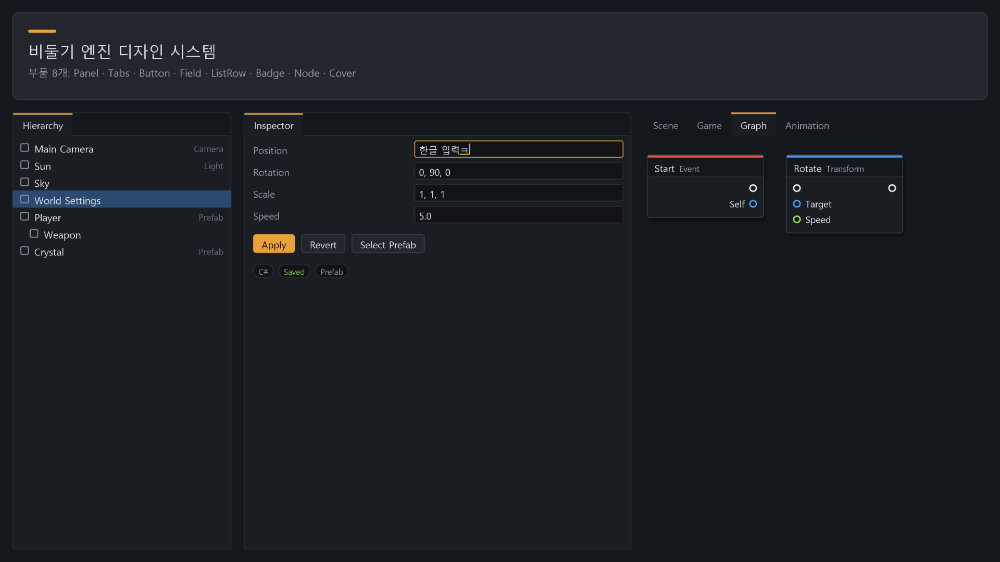
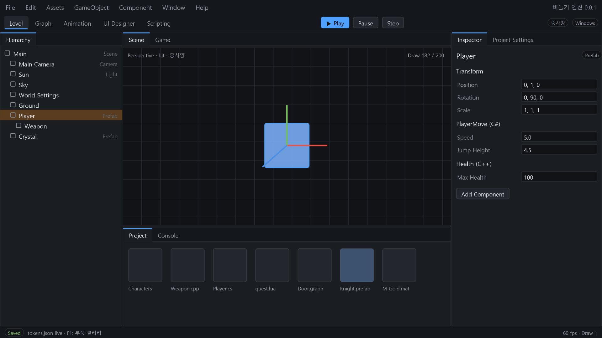
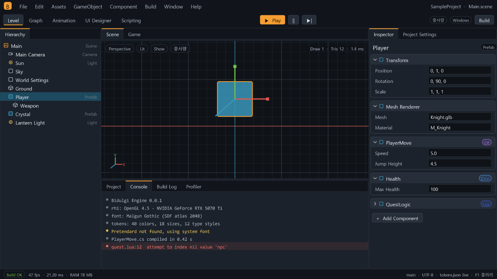
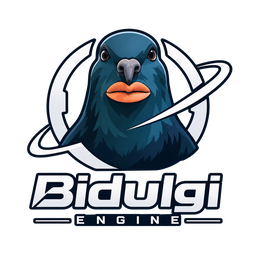

<div align="center">



# Bidulgi Engine (비둘기 엔진)

**AI 친화적인 텍스트 기반 범용 게임 엔진**
겉은 유니티처럼 쉽게, 속은 언리얼처럼 단단하게, 도구는 블렌더처럼.

[](LICENSE)
-5f6670.svg)

-72c04e.svg)



🎬 [소개 영상 (MP4, 24초)](docs-media/bidulgi-intro.mp4)

</div>

> ⚠️ **초기 개발 단계(M0)입니다.** 에디터 화면과 UI 프레임워크가 동작하며, 씬 편집·스크립팅·3D 렌더링은 아직 없습니다. 진행 상황은 [작업 대기열](Docs/QUEUE.md)에서 볼 수 있습니다.

---

## 왜 비둘기 엔진인가

| | 비둘기 엔진 |
|---|---|
| 🤖 **AI와 사람이 같은 방식으로** | UI·터미널·AI 에이전트가 모두 같은 **명령 버스**로 편집합니다. 하나의 Undo, `--dry-run`, MCP 서버, 자동 생성되는 `AGENTS.md` |
| 📄 **모든 데이터는 텍스트** | 씬·프리팹·그래프를 **JSONL**(한 줄에 오브젝트 하나)로 저장. git에서 diff·병합이 되고, AI가 적은 토큰으로 읽고 고칩니다. 배포 빌드는 바이너리로 쿠킹 |
| 🧩 **다섯 언어, 하나의 규칙** | **C#**(유니티 문법) · **C++**(언리얼식 매크로) · **Graph**(비주얼 스크립팅) · **Lua**(Luau) · **Python**(에디터·도구). 모두 같은 생명주기 이름과 C API 허브로 만남 |
| 🎚️ **감자부터 초고사양까지** | 5단계 품질(감자·저·중·고·초고). 같은 장면이 오래된 휴대폰부터 레이 트레이싱 GPU까지 |
| 🇰🇷 **한글 IME 1급 지원** | 자체 UI 프레임워크가 조합 중 글자·후보 창 위치까지 처리. M0의 완료 조건 |
| 🔓 **MIT 라이선스** | 로열티 없음. 템플릿 코드는 0BSD, 템플릿 에셋은 CC0 |

## 지금 동작하는 것 (M0)

| 에디터 | 부품 갤러리 + 한글 입력 |
|---|---|
|  |  |
| **토큰 실시간 반영** (강조색 변경) | **사각형 1만 개 = 드로우콜 1번** |
|  |  |
| **하단 도크: Console (Consolas)** | **브랜드 로고** |
|  |  |

- SDL3 창 + OpenGL 4.5(DSA) RHI, GL 디버그 출력
- 2D 일괄 렌더러: SDF 둥근 사각형·테두리·선·글자를 **드로우콜 1번**에
- FreeType SDF 글자 아틀라스 (13px부터 96px까지 선명한 한글·영문)
- 디자인 토큰(`tokens.json`) 실시간 반영
- 자체 UI 프레임워크: 유지형 위젯 트리, 플렉스 레이아웃, 포커스, 디자인 시스템 부품 8개
- 텍스트 입력: 커서·선택·클립보드·Undo·**한글 IME**
- 고해상도 화면 배율 자동 적용
- **Obsidian Dark** 테마 + 브랜드 색 **Bidulgi Amber `#F59E32`** (로고의 부리 색)
- Inspector 컴포넌트 카드 (접기/펼치기, 언어 배지 C#·C++·Lua), Hierarchy 오브젝트 타입 아이콘
- 하단 도크: Project(파일 타입 아이콘) · Console · Build Log · Profiler(실제 프레임 시간), 코드 글꼴 Consolas
- 상태 줄: 빌드 상태, 실시간 FPS·프레임 시간·메모리
- 기준 성능: 실행부터 첫 화면까지 **585ms**, 에디터 프레임 **1.46ms** (Release, RTX 5070 Ti 노트북)

## 코드 모양 (계획)

```csharp
using Bidulgi;

public class Coin : Behaviour
{
    [Edit] public float spinSpeed = 90f;
    [Edit] public int value = 1;

    void Update(float dt) => transform.Rotate(0, spinSpeed * dt, 0);

    void OnTriggerEnter(Collider other)
    {
        if (!other.gameObject.HasTag("Player")) return;
        Game.GetSystem<ScoreSystem>().Add(value);   // C++ 시스템을 그대로 호출
        Destroy(gameObject);
    }
}
```
같은 예제를 C++·Lua·Python·Graph로 쓴 모습은 [언어별 문법](Docs/features/code-syntax.md)에 있습니다.

## 빌드

필요한 것: Windows, Visual Studio 2022(C++ 데스크톱), CMake 3.24+, git

```powershell
cmake -S . -B build -G "Visual Studio 17 2022" -A x64
cmake --build build --config Release --target BidulgiEditor
.\Bin\BidulgiEditor.exe        # F1: 부품 갤러리 화면
```
테스트 스위치와 자세한 안내는 [Docs/QUEUE.md §0](Docs/QUEUE.md)에 있습니다.

## 로드맵

| 단계 | 내용 | 상태 |
|---|---|---|
| **M0** 기반 | 창, RHI, 2D 렌더러, 글자, UI 프레임워크, 한글 입력 | 🟢 거의 완료 |
| **M1** 에디터 골격 | 도킹, 리플렉션, 명령 버스 + Undo, 핸들 | ⚪ 다음 |
| **M2** 씬과 에셋 | JSONL 씬, 에셋 GUID, Hierarchy·Inspector, `bdg` CLI | ⚪ |
| **M3** 3D | PBR, 그림자, 기즈모, 플레이 모드 | ⚪ |
| **M4~M5** 스크립팅 | C# 핫 리로드, Graph, Lua, Python | ⚪ |
| **M6~M7** 게임 기능 | 프리팹, 물리, 오디오, 입력 액션, 애니메이션 그래프, 빌드 | ⚪ |
| **1.0** | 허브, 템플릿(1인칭 슈팅·3인칭 등), Android·Web, Halo GI Tier 0 | ⚪ |
| **이후** | 멀티플레이, 실시간 공동 편집, 오픈월드·GPU 물리 | ⚪ |

## 문서

- [기획 문서 전체](Docs/README.md) · [결정 기록](Docs/planning/decisions.md) · [작업 대기열](Docs/QUEUE.md)
- 구조: [전체 구조](Docs/architecture/overview.md) · [렌더링과 품질 단계](Docs/architecture/rendering-and-platforms.md) · [스크립팅](Docs/architecture/scripting.md) · [물리](Docs/architecture/physics.md)
- 기능: [데이터 형식](Docs/features/data-formats.md) · [에디터 UI](Docs/features/editor-ui.md) · [AI 에이전트 연동](Docs/features/agent-integration.md) · [전역 조명](Docs/features/global-illumination.md)

## 라이선스

[MIT](LICENSE) © Bidulgi Engine contributors. 외부 라이브러리(SDL3, FreeType, yyjson, glad)의 라이선스는 각 프로젝트를 따릅니다.